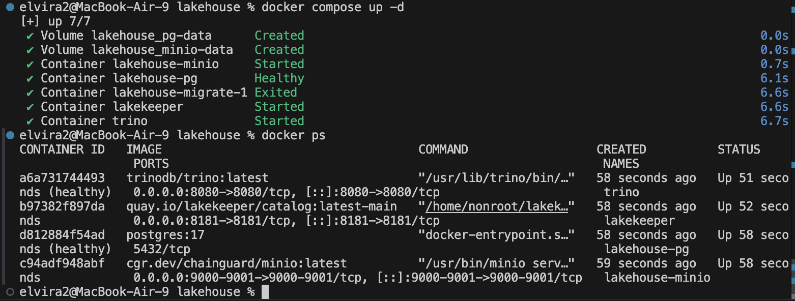

# Отчёт по практической работе №1

Развёртывание локального Lakehouse, ELT-преобразование и бенчмарк форматов/сжатия

## 1. Вариант и масштаб

| Поле | Значение |
|---|---|
| ФИО (как в VK Education) | Абдуллаева Эльвира Кожохматовна |
| Вариант (запрос) | 2 — Q10 «Returned Item Reporting» |
| Масштаб sfN | sf1 |
| Почему выбрал такой масштаб | sf1 даёт около 6 млн строк в lineitem (самая большая таблица). Этого достаточно, чтобы увидеть разницу между кодеками сжатия и между слоями, и при этом всё помещается в память и на диск ноутбука, а запросы выполняются за секунды. Больший масштаб (sf10 и выше) сильно замедлил бы загрузку и бенчмарк без новой информации для задачи. Один и тот же sf1 использован на всех слоях. |

## 2. Поднятые сервисы — и почему именно они

| Сервис | Роль в стеке | Почему именно он (а не альтернатива) |
|---|---|---|
| MinIO | S3-совместимое объектное хранилище (сюда физически падают parquet-файлы) | Открытый исходный код, S3 API, поэтому любой движок работает с ним как с облачным S3, но локально и бесплатно. Образ взят из репозитория Chainguard (`cgr.dev/chainguard/minio`), так как MinIO перестал публиковать образы на Docker Hub и Quay.|
| PostgreSQL | БД, где Lakekeeper хранит метаданные каталога | Lakekeeper требует реляционную БД для метаданных, Postgres надёжен, открыт и штатно поддерживается. Данные хранятся в именованном томе `pg-data`, поэтому настройки каталога переживают пересоздание контейнера.|
| Lakekeeper | Iceberg REST Catalog — каталог метаданных таблиц | Реализует открытый REST-протокол Iceberg, поэтому каталог не привязан к конкретному движку (Trino, Spark и т.д. работают с одним каталогом). Лёгкий, запускается одним контейнером. Авторизация отключена осознанно: стенд локальный и учебный. |
| Trino | SQL-движок: ходит в Lakekeeper за метаданными и читает/пишет данные в MinIO | Распределённый SQL-движок с коннектором Iceberg и встроенным генератором данных TPC-H (`tpch.sfN`), поэтому ничего не нужно скачивать. Стандартный SQL, подключение из DBeaver по JDBC. |
| (Superset / Metabase) | Отчёт/дашборд поверх данных | |

### Скрипты, которыми поднимал стек

```yaml
services:
  minio:
    volumes: ["minio-data:/data"]
    image: cgr.dev/chainguard/minio:latest
    container_name: lakehouse-minio
    command: server /data --console-address ":9001"
    environment: {MINIO_ROOT_USER: admin, MINIO_ROOT_PASSWORD: password123}
    ports: ["9000:9000", "9001:9001"]
  pg:
    volumes: ["pg-data:/var/lib/postgresql/data"]
    image: postgres:17
    container_name: lakehouse-pg
    environment: {POSTGRES_USER: lk, POSTGRES_PASSWORD: lk, POSTGRES_DB: lk}
    healthcheck: {test: ["CMD-SHELL","pg_isready -U lk"], interval: 5s, retries: 10}
  migrate:
    image: quay.io/lakekeeper/catalog:latest-main
    command: ["migrate"]
    environment: &lk
      LAKEKEEPER__PG_ENCRYPTION_KEY: "secretkey123"
      LAKEKEEPER__PG_DATABASE_URL_READ: postgresql://lk:lk@pg:5432/lk
      LAKEKEEPER__PG_DATABASE_URL_WRITE: postgresql://lk:lk@pg:5432/lk
    depends_on: {pg: {condition: service_healthy}}
  lakekeeper:
    image: quay.io/lakekeeper/catalog:latest-main
    container_name: lakekeeper
    command: ["serve"]
    environment: *lk
    ports: ["8181:8181"]
    depends_on: {migrate: {condition: service_completed_successfully}}
  trino:
    image: trinodb/trino:latest
    container_name: trino
    ports: ["8080:8080"]
    volumes: ["./trino/catalog:/etc/trino/catalog"]
    depends_on: [lakekeeper]
volumes:
  minio-data:
  pg-data:
```

Файлы каталогов Trino:

```
# trino/catalog/tpch.properties
connector.name=tpch

# trino/catalog/lake.properties
connector.name=iceberg
iceberg.catalog.type=rest
iceberg.rest-catalog.uri=http://lakekeeper:8181/catalog
iceberg.rest-catalog.warehouse=lakehouse
fs.s3.enabled=true
s3.endpoint=http://minio:9000
s3.path-style-access=true
s3.region=us-east-1
s3.aws-access-key=admin
s3.aws-secret-key=password123
```

Ручные шаги: в MinIO создан бакет `lakehouse`; в Lakekeeper выполнен bootstrap и создан warehouse `lakehouse` (тип S3 compatible, endpoint `http://minio:9000`, path-style включён, vended credentials и remote signing выключены); затем `docker restart trino`.

Вывод `docker ps`:




## 3. Разбор запроса — какие данные нужны

Q10 находит топ-20 клиентов по выручке от возвращённых позиций за 4-й квартал 1993 года.

| Таблица TPC-H | Нужные колонки | Что запрос с ними делает (фильтр / джойн / агрегат / вывод) |
|---|---|---|
| customer | custkey, name, acctbal, address, phone, comment, nationkey | custkey: джойн с orders и группировка; name, acctbal, address, phone, comment: вывод и группировка; nationkey: джойн с nation |
| orders | orderkey, custkey, orderdate | custkey: джойн с customer; orderkey: джойн с lineitem; orderdate: фильтр по Q4 1993 (с 1993-10-01 до 1994-01-01) |
| lineitem | orderkey, extendedprice, discount, returnflag | orderkey: джойн с orders; extendedprice и discount: агрегат sum(extendedprice * (1 - discount)) как revenue; returnflag: фильтр = 'R' (возвращённые позиции) |
| nation | nationkey, name | nationkey: джойн с customer; name: вывод как nation |

Остальные колонки TPC-H запросу не нужны, поэтому в слои они не переносились.

## 4. Медальон — решения по каждому слою

Во всех слоях формат Parquet, сжатие ZSTD (в Bronze дополнительно сравнивается с GZIP в разделе 5), партиционирование не применялось. Размеры взяты из `SELECT sum(file_size_in_bytes)/1024.0/1024 FROM <таблица>$files`, число строк из `SELECT count(*)`.

### Bronze (сырой)

| Таблица | Колонки (что оставил) | Строк | Вес, МБ | Формат | Сжатие | Партиционирование | Обоснование |
|---|---|---|---|---|---|---|---|
| customer | custkey, name, address, nationkey, phone, acctbal, comment | 150000 | 7.23 | PARQUET | ZSTD | нет | Parquet колоночный: запрос читает не все колонки, а нужные, поэтому читается меньше данных. ZSTD сжимает хорошо и не нагружает процессор, а на бенчмарке оказался лучше GZIP. Партиции не нужны: таблица всего 7 МБ, разбиение дало бы лишние мелкие файлы. |
| orders | orderkey, custkey, orderdate | 1500000 | 6.66 | PARQUET | ZSTD | нет | Оставила только три колонки, нужные запросу (orderkey, custkey, orderdate), поэтому таблица занимает 6.7 МБ. Parquet + ZSTD дают компактное хранение и быстрое чтение. Партиционирование по дате не использовала: при таком объёме оно только замедлит запрос, а фильтр по датам и так быстро работает по статистике внутри Parquet. |
| lineitem | orderkey, extendedprice, discount, returnflag | 6001215 | 30.96 | PARQUET | ZSTD | нет | Самая большая таблица (6 млн строк), поэтому формат важнее всего. Parquet читает только 4 нужные колонки из 16, ZSTD уменьшает размер до 31 МБ. Партиции не делала: объём небольшой, а запрос читает таблицу целиком для джойна. |
| nation | nationkey, name | 25 | 0.0006 | PARQUET | ZSTD | нет | Справочник из 25 строк (меньше 1 КБ). Формат и сжатие выбраны такие же, как у остальных таблиц Bronze, чтобы слой был единообразным. Партиционирование бессмысленно для таблицы такого размера. |
| **Итого Bronze** | | 7651240 | **44.86** | | | | |

Расчёт итога: 7.2306 + 6.6608 + 30.9634 + 0.0006 = 44.8554 МБ (≈ 44.86).

Примечание: в таблице выше указаны числа для варианта ZSTD (это основной вариант Bronze). Для бенчмарка в разделе 5 я пересоздала Bronze с GZIP, итоговый размер у GZIP получился 45.05 МБ. Silver и Gold строились из Bronze с ZSTD и не пересоздавались.

### Silver (очищенный)

| Таблица | Колонки (что оставил) | Строк | Вес, МБ | Формат | Сжатие | Партиционирование | Обоснование |
|---|---|---|---|---|---|---|---|
| customer_nation | custkey, name, address, phone, acctbal, comment, nation | 150000 | 7.23 | PARQUET | ZSTD | нет | Джойн customer и nation сделан заранее, чтобы в Gold не повторять его и сразу иметь название страны. Parquet + ZSTD, как в Bronze, чтобы слои были единообразны. Партиции не нужны: 150 тысяч строк и 7 МБ. |
| orders_q4_1993 | orderkey, custkey, orderdate | 57069 | 0.36 | PARQUET | ZSTD | нет | Срез по кварталу: оставила только заказы с 1 октября 1993 по 1 января 1994, это 57 тысяч строк вместо 1,5 млн. Parquet + ZSTD. Партиционирование по месяцу не применяла: в срезе всего три месяца и 0.36 МБ, партиции дали бы только лишние мелкие файлы. |
| lineitem_returned | orderkey, extendedprice, discount | 1478870 | 7.74 | PARQUET | ZSTD | нет | Оставила только возвращённые позиции (returnflag = 'R'), это 1,48 млн строк из 6 млн, а сам столбец returnflag больше не нужен и убран. Размер упал с 31 до 7.7 МБ. Parquet + ZSTD, партиции не нужны при таком объёме. |

Эффект фильтрации относительно Bronze:
- orders: 1 500 000 → 57 069 строк (≈ 3,8 %), вес 6.66 → 0.36 МБ;
- lineitem: 6 001 215 → 1 478 870 строк (≈ 24,6 %), вес 30.96 → 7.74 МБ.

Замечание: данные TPC-H генерируются уже чистыми (без пропусков и дублей), поэтому «очистка» в Silver сводится к фильтрации по условиям запроса, отбору колонок и обогащению (джойн со странами). Партиционирование по месяцу `orders_q4_1993` не применялось: в срезе всего три месяца и 0.36 МБ, партиции дали бы лишь лишние мелкие файлы. 

### Gold (витрина)

| Таблица | Колонки | Строк | Вес, МБ | Формат | Сжатие | Партиционирование | Обоснование |
|---|---|---|---|---|---|---|---|
| top20_returns | custkey, name, revenue, acctbal, nation, address, phone, comment | 20 | 0.0031 | PARQUET | ZSTD | нет | Готовый ответ на запрос Q10: топ-20 клиентов по выручке от возвратов за 4 квартал 1993. В таблице 20 строк и 3 КБ, поэтому BI читает её мгновенно. Parquet + ZSTD для единообразия со всеми слоями, партиционирование не нужно: разбивать 20 строк бессмысленно. |

SQL, которым создавались слои:

```sql
-- Bronze (для customer, orders, lineitem, nation со своими колонками)
CREATE SCHEMA lake.bronze;
CREATE TABLE lake.bronze.lineitem
WITH (format='PARQUET', compression_codec='ZSTD') AS
SELECT orderkey, extendedprice, discount, returnflag FROM tpch.sf1.lineitem;


-- Silver
CREATE SCHEMA lake.silver;
CREATE TABLE lake.silver.customer_nation
WITH (format='PARQUET', compression_codec='ZSTD') AS
SELECT c.custkey, c.name, c.address, c.phone, c.acctbal, c.comment, n.name AS nation
FROM lake.bronze.customer c JOIN lake.bronze.nation n ON c.nationkey = n.nationkey;

CREATE TABLE lake.silver.orders_q4_1993
WITH (format='PARQUET', compression_codec='ZSTD') AS
SELECT orderkey, custkey, orderdate FROM lake.bronze.orders
WHERE orderdate >= DATE '1993-10-01' AND orderdate < DATE '1994-01-01';

CREATE TABLE lake.silver.lineitem_returned
WITH (format='PARQUET', compression_codec='ZSTD') AS
SELECT orderkey, extendedprice, discount FROM lake.bronze.lineitem WHERE returnflag = 'R';

-- Gold
CREATE SCHEMA lake.gold;
CREATE TABLE lake.gold.top20_returns
WITH (format='PARQUET', compression_codec='ZSTD') AS
SELECT c.custkey, c.name, sum(l.extendedprice * (1 - l.discount)) AS revenue,
       c.acctbal, c.nation, c.address, c.phone, c.comment
FROM lake.silver.customer_nation c
JOIN lake.silver.orders_q4_1993 o ON c.custkey = o.custkey
JOIN lake.silver.lineitem_returned l ON l.orderkey = o.orderkey
GROUP BY c.custkey, c.name, c.acctbal, c.nation, c.address, c.phone, c.comment
ORDER BY revenue DESC LIMIT 20;
```

Слои связаны: Gold строится из Silver, Silver из Bronze, Bronze из `tpch.sf1`. Результат Gold: 20 строк, первая строка — клиент 57040 с выручкой около 734 235.

## 5. Тесты производительности

Тестовый запрос — Q10, выполненный по таблицам `lake.bronze.*` (с джойнами customer, orders, lineitem, nation).

| Сжатие на Bronze | Время запроса, с (3 запуска) | Среднее, с | Размер Bronze, МБ | Твой вывод (что лучше и почему) |
|---|---|---|---|---|
| GZIP | 5.862 / 2.228 / 1.922 | 3.34 | 45.05 | В моём тесте GZIP вышел хуже по обоим пунктам: он медленнее и файлы получились чуть больше. |
| ZSTD | 4.115 / 2.013 / 1.575 | 2.57 | 44.86 | ZSTD оказался быстрее и немного меньше по размеру. Для Bronze я выбираю его. |

Расчёты:
- GZIP: (5.862 + 2.228 + 1.922) / 3 = 10.012 / 3 ≈ 3.34 с. Без первого запуска (прогрев): (2.228 + 1.922) / 2 ≈ 2.08 с.
- ZSTD: (4.115 + 2.013 + 1.575) / 3 = 7.703 / 3 ≈ 2.57 с. Без первого запуска: (2.013 + 1.575) / 2 ≈ 1.79 с.
- Разница по времени: GZIP медленнее примерно на 30 % (3.34 против 2.57 с), а без прогрева примерно на 16 % (2.08 против 1.79 с).
- Размер Bronze: GZIP 45.05 МБ, ZSTD 44.86 МБ. Разница около 0.19 МБ, то есть меньше 0.5 %.

Вывод: размер почти одинаковый, GZIP даже чуть больше, а по времени ZSTD быстрее. Значит, на моих данных (sf1, около 45 МБ) GZIP ничего не даёт, и ZSTD лучше по обоим показателям. Я думала, что GZIP сожмёт сильнее, но не вышло. Скорее всего, потому что внутри Parquet данные уже закодированы словарями и RLE, и кодек сжимает уже небольшой остаток. Надо учитывать, что объём маленький и запросы идут 2-6 секунд, поэтому часть разницы по времени может быть просто шумом. Первый запуск у обоих кодеков самый медленный (5.9 и 4.1 с), потому что идёт прогрев.

Как замерял: Q10 запускал 3 раза подряд по таблицам lake.bronze.* для каждого кодека. Время взято из system.runtime.queries как разница между end и created. Размер Bronze равен сумме file_size_in_bytes по четырём таблицам из $files. Для GZIP все 4 таблицы Bronze были удалены (DROP TABLE) и созданы заново с compression_codec='GZIP'.

## 6. Часть 2 — осмысление и работа с инструментами

### 6.1. Понять и объяснить

| Вопрос | Твой ответ |
|---|---|
| Зачем нужны большие данные и lakehouse (а не обычная БД/хранилище)? | объёмы не помещаются в одну БД; данные в дешёвом объектном хранилище, вычисления отдельно; открытые форматы Parquet/Iceberg без привязки к вендору; ACID, schema evolution и time travel поверх файлов; одни и те же данные для BI и для ML |
| Пример schema evolution на Silver: добавил/переименовал колонку — что произошло? | см. ниже* |
| Пример скрипта восстановления данных из снапшота (time travel) | см. скрипт ниже |
***Schema evolution на lake.silver.customer_nation**

1. Добавила новую колонку командой `ALTER TABLE lake.silver.customer_nation ADD COLUMN test_col varchar;`.
2. Сделала `SELECT * FROM lake.silver.customer_nation LIMIT 5;`. В результате появилась новая колонка `test_col`, а у всех старых строк в ней `NULL`.
3. Таблицу я не пересоздавала и данные не терялись. В Iceberg при ADD COLUMN меняются только метаданные, а parquet-файлы с данными не переписываются. Поэтому новый снапшот при этом не появился (в $snapshots остался один, см. ниже).

Почему это удобно: в обычной БД ALTER на большой таблице может блокировать её или переписывать все данные, а в lakehouse схему можно менять быстро и без потерь.

Команды для schema evolution:

```sql
ALTER TABLE lake.silver.customer_nation ADD COLUMN test_col varchar;
SELECT * FROM lake.silver.customer_nation LIMIT 5;
ALTER TABLE lake.silver.customer_nation RENAME COLUMN test_col TO note;
```

Команды для time travel:

```sql
-- 1. список снапшотов
SELECT snapshot_id, committed_at, operation
FROM lake.silver."customer_nation$snapshots" ORDER BY committed_at;

-- 2. испортила данные
DELETE FROM lake.silver.customer_nation WHERE custkey <= 1000;
SELECT count(*) FROM lake.silver.customer_nation;   -- 149000

-- 3. смотрю старую версию
SELECT count(*) FROM lake.silver.customer_nation
FOR VERSION AS OF 583759850428117183;               -- 150000

-- 4. откат к старому снапшоту
ALTER TABLE lake.silver.customer_nation EXECUTE rollback_to_snapshot(583759850428117183);

-- 5. проверка
SELECT count(*) FROM lake.silver.customer_nation;   -- 150000
```
**Time travel на lake.silver.customer_nation**

1. Посмотрела список снапшотов запросом `SELECT snapshot_id, committed_at, operation FROM lake.silver."customer_nation$snapshots" ORDER BY committed_at;`. Получился один снапшот: `583759850428117183`, операция `append` (так записалось создание таблицы через CREATE TABLE AS), время 2026-10-17 15:42:25. Это состояние таблицы до всех моих изменений (150000 строк).
2. Чтобы откат был виден, я «испортила» данные: `DELETE FROM lake.silver.customer_nation WHERE custkey <= 1000;`. После этого `SELECT count(*)` показал 149000 вместо 150000. Значит, удалилось 1000 строк.
3. Старая версия: `SELECT count(*) FROM lake.silver.customer_nation FOR VERSION AS OF 583759850428117183;` показала 150000, то есть старые данные остались доступны.
4. Откат: выполнила команду из скрипта выше, после этого `SELECT count(*)` показал 150000.

Это работает потому, что Iceberg не удаляет старые файлы при DELETE. Он создаёт новый снапшот, а старый остаётся в истории, и к нему можно вернуться.


### 6.2. Подключить инструмент к lakehouse

| Инструмент | Почему выбрал именно его |
|---|---|
| Metabase | Открытый исходный код, поднимается одним контейнером без дополнительной настройки. Имеет встроенный драйвер Starburst/Trino, поэтому подключается к тому же Trino, который работает с Lakekeeper и MinIO, и ничего не нужно устанавливать вручную. Интерфейс для запросов без кода, поэтому видно данные Bronze за пару кликов. Superset я не брала, потому что для Trino в нём надо отдельно ставить драйвер, а для учебной задачи это лишнее. |

Скрипт развертывания:

```yaml
  metabase:
    image: metabase/metabase:latest
    container_name: metabase
    ports: ["3000:3000"]
```

Мои действия в UI/консоли (как подключился и увидел данные Bronze):

1. Добавила сервис metabase в docker-compose.yml и выполнила `docker compose up -d`.
2. Открыла http://localhost:3000 и создала локальную учётную запись.
3. Добавила базу данных типа Starburst: host `trino`, port `8080`, catalog `lake`, schema `bronze`, user `admin`. Host указан как `trino`, а не `localhost`, потому что Metabase обращается к Trino изнутри Docker-сети.
4. Через Browse data открыла таблицу `lineitem` и увидела данные Bronze (6 001 215 строк, колонки orderkey, extendedprice, discount, returnflag).
5. Построила вопрос: количество строк lineitem по returnflag. Это показывает, что BI-инструмент читает данные из Parquet-файлов в MinIO через Trino и Lakekeeper.

## 7. Выводы

Медальон помог разделить данные по смыслу: Bronze хранит нужные колонки почти как в источнике (45 МБ), Silver уже отфильтрован и обогащён, а Gold это готовый ответ на запрос на 20 строк (0.0031 МБ). Из-за этого итоговый запрос к Gold работает мгновенно, а не гоняет миллионы строк. Parquet с сжатием хранит данные компактно, а в тесте ZSTD оказался лучше GZIP: он быстрее (2.57 против 3.34 с) и почти не отличается по размеру (44.86 против 45.05 МБ). Выбранный стек открытый и каждая часть заменяется отдельно: MinIO хранит файлы, Lakekeeper ведёт каталог, Trino считает. Schema evolution и time travel в Iceberg позволили менять схему без переписывания данных и откатить случайное удаление.